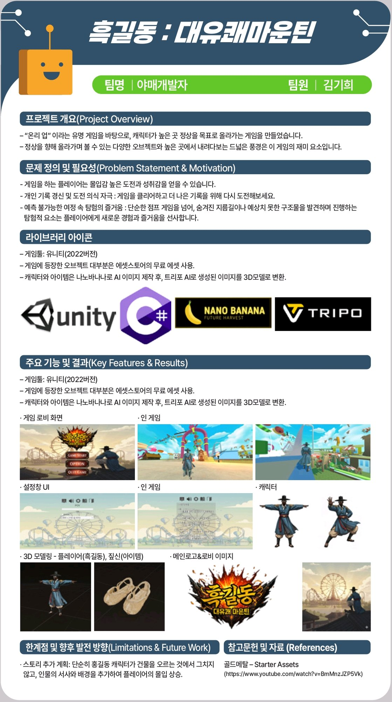
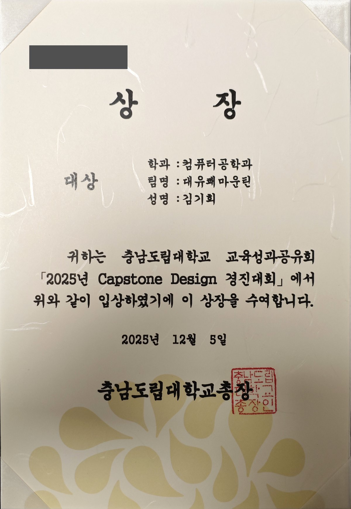

<div align="center">

# 흑길동 : 대유쾌마운틴

**점프 입력 누락 문제를 점프 버퍼 로직으로 해결하고,**
**테스터 피드백 기반 레벨 디자인을 개선한 Unity 3D 플랫포머 게임**

<br/>

[](https://vimeo.com/1157451424)
[](https://drive.google.com/file/d/1BDh63ggmo_Zhu1bhHyxM4UVa7_0XmLQQ/view)

<br/>

**개발 환경** · Unity · C# · Windows

*충남도립대학교 3학년 2학기 캡스톤디자인 출품작*

</div>

---

## 스크린샷

<div align="center">


<br/><br/>


</div>

---

## 문제 해결 기록

### PROBLEM 01 · 내리막길 점프 입력 누락

> 내리막길 고속 이동 중 지면 판정이 순간적으로 해제되며 점프 조건이 충족되지 않는 문제

**Jump Buffer Processing Flow**

```
지면 접촉 상태
    │
    ▼
내리막 / 고속 이동 → 순간적 지면 이탈 감지
    │
    ▼
Coyote Timer 시작  ──── 0.3s 코루틴 ────►  점프 입력 감지 시 → 점프 실행
    │                                                   │
    │                                          점프 입력 없을 시
    │                                                   │
    └───────────────────────────────────────► 타이머 종료 → 일반 규칙 적용
```

| 구분 | 내용 |
|------|------|
| **문제** | 속도가 빨라질수록 점프 입력 누락 빈도 증가 |
| **원인** | 지면 판정이 순간 해제되며 점프 조건 미충족 |
| **해결** | 코루틴으로 지면 이탈 후 **0.3초 이내** 입력을 점프로 처리 |
| **결과** | 고속 이동 상황에서도 입력 손실 없는 조작감 확보 |

---

### PROBLEM 02 · 길찾기 혼란 (테스터 피드백)

> 플레이 테스트에서 맵 내 진행 경로 파악이 어렵다는 피드백 다수 발생

| 구분 | 내용 |
|------|------|
| **문제** | 지형 구조만으로는 올바른 루트를 직관적으로 인지하기 어려움 |
| **해결** | 버섯 오브젝트를 길 유도 요소로 배치 + 발광 효과로 가시성 강화 |
| **결과** | 진행 경로 인지율 향상 및 맵 탐색 스트레스 감소 |

---

## 저장소 구성

| 구분 | 저장 위치 | 형태 |
|------|-----------|------|
| 핵심 스크립트 | GitHub (이 저장소) | `.cs` 파일 |
| 고용량 에셋 | 네이버 MyBox | Unity Package |

> 에셋 용량 문제로 중요 스크립트만 Git에 버전 관리하고,
> 나머지 리소스는 네이버 MyBox에 Package 형태로 백업합니다.

---

## 캡스톤디자인 성과

충남도립대학교 교육성과공유회 **2025년 Capstone Design 경진대회 대상**을 수상했습니다. **수여일: 2025.12.05**

### 프로젝트 소개 포스터

<a href="docs/images/project-poster.jpg"></a>

이미지를 누르면 확대해서 볼 수 있습니다.

### 대상 상장

<a href="docs/images/capstone-2025-grand-prize.jpg"></a>

문서번호를 가린 공개용 사진입니다. 상장 문구와 직인은 유지했으며, 이미지를 누르면 확대할 수 있습니다.

---

<div align="center">

**김기희** · [github.com/darkflame265](https://github.com/darkflame265) · ter2490@naver.com

</div>
